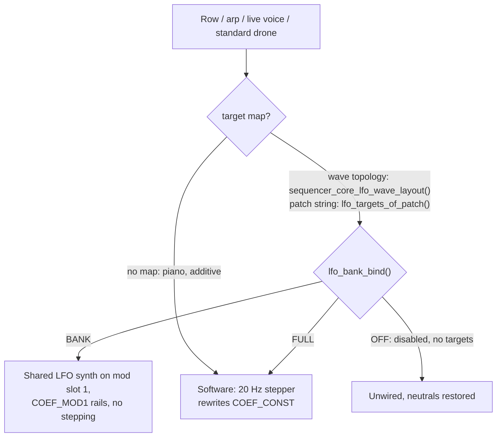

# Engine semantics - app conventions over AMY

Rules the sequencer, arp, drone and live voice share when they drive AMY, and
that no single header can state alone. AMY's own parameter semantics (control
coefficients, breakpoint sets, log2 pitch, dB amp combine) are documented in
`components/amy/docs/synth.md` and `components/amy/docs/api.md`; this file states only what the app
does on top of them. Source comments cite a section here instead of repeating
it.

## LFO: native carrier vs software stepper

With `CONFIG_SEQ_LFO_SHARED` (the default) an LFO reaches the sound one of two
ways: a shared LFO synth, or the software stepper when none can be had.

**Shared LFO synth.** Every distinct LFO source (wave, rate and the three
wobble settings) runs once, as a two-osc AMY synth of its own above the slot
map (`lfo_bank.h`): the carrier at the BPM-synced rate, RANDOM mapped to the
NOISE sample-and-hold, and the wobble modulator chained behind it
(`voice_lfo_source_apply()`). Every voice using that source for its LFO1
names the synth in its mod slot 1 (LFO2 uses slot 0, below), and each checked
target's COEF_MOD1 depth is set once
(`voice_lfo_wire()`, `voice_config.c`): filter, amp, pitch, scan, pan and both
distortion rails. Nothing is stepped, so there is no zipper. The per-target
depth scalars are the `VOICE_LFO_DEPTH_*` constants in `voice_config.h`.
The LFO synth is created free-running (`SYNTH_FLAGS_FREE_RUN_MOD`): AMY
advances it every block whether or not its voices sound, so every voice on it
shares one phase that keeps time across rests. While the transport plays it
is also bar-locked: warped onto the bar grid when created and again at each
bar line, so every LFO cycle starts on the grid counted from the bar baseline
(a carrier whose rate the wobble swings is left free; contract in
`lfo_bank.h`).
Which oscs take which rail comes from the voice: a wave-topology voice (raw
wave, wavetable, bass preset; `sequencer_core_lfo_wave_layout()`, lifted over
the row's unison layout by `seq_track_voice_layout()`) or a patch-string
family map (`lfo_targets_of_patch()`, `lfo_targets.h`). Wave voices reserve no
LFO oscs. A depth or target change re-wires; a source change moves the voice
to another LFO synth, acquiring the new one before releasing the old.

**Software.** A voice with no shared LFO synth - the bank is full, or the
patch has no target map - falls back to the 20 Hz stepper
(`sequencer_core_lfo_service()` for sequencer rows, with the same law in
`arp_core.c` and `live_play.c`; mechanics in `sequencer_core/software_lfo.md`),
which recomputes each checked target and re-sends it. The rate is capped at
`SEQ_LFO_SW_MAX_HZ`. WOBBLE and SCAN have no software analog. Pitch is written
to osc 0's COEF_CONST only, because a synth-wide event would also rewrite the
patch's internal modulator oscs' freq CONST, which is their rate. AMP is not an
amp CONST write: it is the stepper-dip factor of the synth's level
(`synth_level_set_sw_lfo()`, `synth_level.h`), so each osc's authored level
and the oscs a patch parks at CONST 0 stay as they are. The standard drone has
no stepper: past a full bank it runs without an LFO.

**One state.** Whether a voice is on a shared LFO synth is its bank reference
(per row `s_lfo_synth`, and one each in the arp, live voice and drone); the
stepper runs only while that reference is empty, so the two never modulate the
same voice. The LFO editor's WOBBLE rows follow the same state.

**Two LFOs.** Every voice block carries a second LFO (`voice_params_t.lfo2`).
AMY has two mod slots per osc: slot 1 is LFO1's (`VOICE_LFO_SLOT_LFO1`), slot 0
is LFO2's (`VOICE_LFO_SLOT_LFO2`, `voice_config.h`). LFO2 binds through the
same bank and depth laws, with its own reference per consumer
(`s_lfo2_synth` per row), and LFO1 and LFO2 of one voice with equal source
fields share one LFO synth. LFO2 has no stepper: with a full bank it is inert.
Each target belongs to at most one LFO (`lfo.targets & lfo2.targets` is 0):
the setters and the project loader take a shared target away from LFO2, so
only one LFO can own AMP and only one slot's overshoot cap is ever below 1
(`synth_level.h`). At every patch apply or rebuild the order is the patch
string, then LFO1, then LFO2.

LFO2 is open or collapsed (`lfo2_authored`, release group
`SEQ_VP_GROUP_LFO2`) and, separately, on or off (`lfo2.enabled`). The slot-0
rule:

- Collapsed: no slot-0 send at all. Juno (patches 0..127) and DX7 (128..255)
  strings wire slot 0 to their own LFO (osc 1, `L1`;
  `lfo_targets_patch_owns_slot0()`), which keeps playing.
- Open: slot 0 is LFO2's. It is wired while LFO2 runs (on, with targets, on a
  mapped patch) and unwired otherwise, so on a Juno or DX7 patch an open LFO2
  that is off leaves the patch LFO off too.
- Open to collapsed: on a Juno or DX7 patch the patch is re-applied, the only
  way back to its slot-0 wiring and depths (a melodic row through release to
  patch, which reloads the layer; the arp, drones and live voice rebuild their
  slot). On other families collapse is a plain unwire. The family decides;
  AMY's slot-0 state is not read.

On a sequencer row the reload tail binds both LFOs through the open editor's
preview copy when one is up, so a reload during a preview keeps what is being
auditioned.

**Distortion.** DRIVE and MIX are independent target bits. AMY has MOD rails
for both (`dist_logdrive_coefs`, `dist_mix_coefs`), so on a shared LFO synth
they ride it like every other target; the stepper drives them only when it
serves the voice (`voice_push_dist_lfo()`), with the same law. The per-target
depth law (drive in octaves, mix linear) is stated in the top-level README,
LFO editor section. With the shaper OFF the target is inert: the LFO never
switches distortion on.

**Without `CONFIG_SEQ_LFO_SHARED`** each wave-topology voice reserves a
trailing carrier and wobble osc pair that its audible oscs name as
`mod_source` on slot 0 (`voice_apply_native_lfo_topo()`), patch strings stay on
the stepper, and `sequencer_core_lfo_native_layout()` is the one predicate
every gate uses. LFO2 is stored and saved there but does nothing.

## Voice blocks and deferred authority

Each melodic row owns one AMY synth slot and reads its editable voice
parameters (`voice_params_t`: EG0, EG1, filter, LFO, distortion, trim) from one
of two stored blocks.

- **Source selector.** A row reads its own block or the layer's shared one;
  the API contract is in `sequencer_core.h`, "Voice-block source selector".
  Every push, service and editor path resolves the block through
  `seq_track_vp()`, and a commit reaches every row reading the written block
  (`sequencer_core_melodic_vp_peers()`).
- **Deferred authority.** The patch owns a parameter group until the user
  commits it in an editor, which sets the group's `*_authored` flag. Authored
  groups are pushed to AMY after every patch load; unauthored groups are left
  to whatever the patch string baked in. Raw waves and wavetables have no
  built-in EG0, so their envelope is always pushed. A zeroed block is
  unauthored but has zero trim, which is silent; `voice_params_init_defaults()`
  is the one place the unity trim is set.
- **Release to patch.** `sequencer_core_release_melodic_group()` clears one
  group's flag on the block the row reads and reloads the layer so the patch's
  own values sound again; the stored values stay for a later commit.
- **Drum rows** are the exception: their defaults are app data, so an
  unauthored drum row's model is seeded from the drum bank's tuning blocks and
  pushed, and the editors open on the curve that is sounding.

## Editor preview and cancel

Editors audition scratch values against the running engine without touching
the store or the authored flags. A preview call pushes to AMY only. Commit goes
through the normal setter. Cancel re-pushes the stored state through the same
preview calls - except for a never-authored row, whose live state came from the
patch and cannot be rebuilt from the store: cancel then calls
`sequencer_core_reload_layer_synth()`, which restarts the layer's voices
briefly. On a LAYER-source row the preview and the cancel-restore run over the
whole peer set. The LFO preview also occupies a slot the software stepper reads,
so editors call `sequencer_core_preview_melodic_clear()` on every close path,
commit and cancel alike.

## Where each AMY-facing fact is stated

| Fact | Home |
|---|---|
| freq COEF_CONST is Hz stored as log2(f/440); pitch pushes anchor on 440 Hz | `SEQ_LFO_PITCH_BASE_HZ`, `voice_config.h` |
| Amp combine is in dB; wobble and the AMP LFO target apply downward-only | `VOICE_WOB_DEPTH_AMP`, `VOICE_LFO_DEPTH_AMP`, `voice_config.h` |
| A never-configured breakpoint set reads as a constant 1.0 | `sequencer_core_push_envelope_eg1()`, `sequencer_core.h` |
| An unconfigured osc plays a full-level SINE, so reserved oscs are parked | `voice_wave_cfg_t`, `voice_config.h` |
| An event naming osc N reaches osc N of every voice | "Reach" in `voice_config.h` |
| Note-offs match by note number | `seq_apply_track_note()`, `seq_core_engine.c` |
| Clear the schedule before a patch rebuild | `sequencer_reconfigure_layer_paused()`, `seq_core_synth.c` |
| Juno patch strings end with EQ/chorus commands, so bus FX are reasserted | `synth_ui_fx_reassert()`, `amy_fx.h` |
| An inactive FX bus is held muted | `fx_push_eq()` group, `amy_fx.h` |
| Send is not apply; lock order; NOTE vs CONFIG route | `amy_helpers.h` |
| The render task cannot send; trig jobs use the pump's urgent source | `seq_trig_pump.c` |
| Plain vs decorated step | `seq_core_trig.c` |
