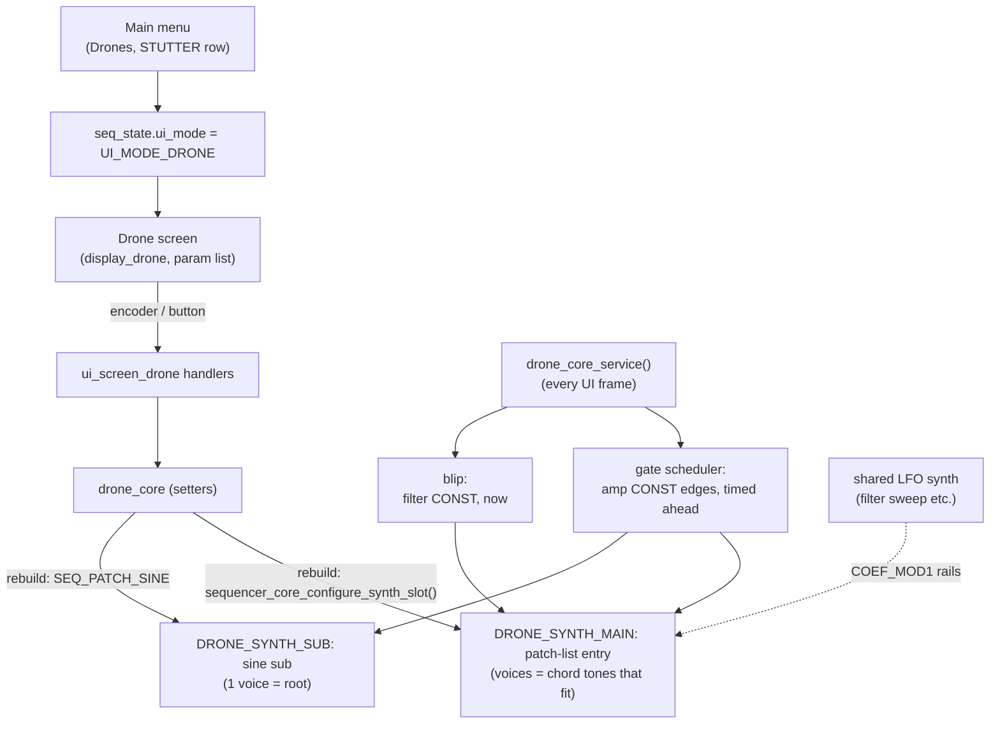

# Stutter House Drone — Architecture

A standalone, tempo-synced **drone synth** translated from an AMYboard
"stutter house drone" Python sketch. It is fully independent of the sequencer
layers, the arp, and the chord progression — its own AMY synth slots, its own
state, its own screen, reached from the normal drone's STUTTER row (the
free-running drone is `Drones` in the menu). It was the first inhabitant
of the `custompatches/` subfolder, now also home to the bass presets, the FM
voice, and the resampler.

```
Any patch-list entry (a raw wave, a wavetable, a Juno or DX7 preset), chopped
by a tempo-locked gate (the "stutter"), through a filter whose cutoff a slow
LFO sweeps (an LPF24 and a 4-bar sine by default). The carrier plays a CHORD;
a sine sub tracks the chord root an octave (or more) below, gated with it.
Everything (stutter rate, LFO period, gate pattern, ADSR fade) locks to the
global BPM.
```

## Files

| File | Role |
|---|---|
| `custompatches/drone_core.c` / `include/custompatches/drone_core.h` | The engine: state, AMY synth config, note scheduling, tempo-locked service. |
| `../synth_ui/ui_screen_drone.c` | The screen's input handling and view building. |
| `../../display/display_drone.{c,h}` | The screen renderer (scrollable label:value list, with the PATTERN row's step glyph). |
| `custompatches/drone_common.{c,h}` | Note emitter, chord voicing and truncation, envelope store, shared with the normal drone. |
| `main/main.c` | Sets `amy_cfg.max_synths` from `AMY_SYNTH_COUNT` (the slot map plus the shared LFO synths). |
| `main/input_dispatch.c` | Routes drone-screen input. |

The module mirrors the **arp module** pattern 1:1 (standalone engine + own synth
slots + own screen, driven from the menu). If you understand `arp_core`, you
understand this.

### The sibling: the normal (free-running) drone

`custompatches/drone_std_core.c` is a second, independent drone engine on its
own slots **4 / 5** (`DRONE_STD_SYNTH_MAIN` / `_SUB`), so both drones can sound
at once. It shares this module's chord voicing and note emitter
(`custompatches/drone_common.{c,h}`) but drops everything tempo-locked: no
stutter gate, no PEAK/DUCK amp coupling, no pattern/blip/swing service, no
swept filter.

Its sound is one entry of the unified patch list (`SEQ_PATCH_*`, cycled in
the `drone_patch_excluded()` domain), applied through the shared apply path
(`sequencer_core_configure_synth_slot()`) like a melodic row, the arp or the
live voice. The main synth gets as many voices as the patch's osc budget
allows (`drone_voices_for()`), up to five; when fewer voices than chord tones
fit, the drone keeps the root, then the fifth, then the top tone, then the
rest in chord order (a Juno patch keeps five tones, an FM voice four, an
additive voice two, the piano one). LEVEL is the amp CONST of the patch's
head osc (osc 0 of a wave, the Juno SILENT head, the DX7 and FM ALGO osc, the
additive partials' parent; both bass oscs, each scaled by the preset's own
balance), replacing the patch's own head level; the piano keeps its own
level. After every rebuild the drone re-imposes what the user authored, the
way the live voice does: the envelopes, the filter with its envelope routing
matrix (EG0/EG1 to cutoff, pitch, drive, mix, and scan on a wavetable), the
distortion and the LFOs (LFO1, then LFO2 while open; shared LFO synths,
`lfo_bank.h`). The sub is a fixed
one-voice sine at SUB INT below the root (-1..-36): level and EG0 only, no
filter, LFO or distortion.

Its screen rows: STUTTER (opens the stutter drone), DRONE, PATCH (name),
ROOT, CHORD, FOLLOW, LEVEL, SUB, SUB INT.

Everything below in this document describes the **stutter** drone unless it
says otherwise.

## Signal flow



## Voice model

The main synth plays one `SEQ_PATCH_*` id from the unified patch list,
applied through the shared apply path (`sequencer_core_configure_synth_slot()`,
the one a melodic row, the arp and the live voice use) at as many voices as the
patch's osc budget allows (`drone_voices_for()`), up to
`DRONE_CHORD_MAX_NOTES`. The domain is `drone_stutter_patch_excluded()`: the
normal drone's (`drone_patch_excluded()`: everything this build compiles in
except NOISE and KS) minus the patches the gate has no osc for (the piano).

The gate, the filter and the LFO wiring address the oscs of the patch's
**target map** - the
voice mask the LFO wiring uses: osc 0 on a wave voice
(`sequencer_core_lfo_wave_layout()`), and for a patch string the
`lfo_targets_of_patch()` voice mask, which is the SILENT head on a Juno (its
VCA and filter), the ALGO control osc on a DX7 or FM voice, the partials'
parent on an additive voice, and both oscs of a bass preset (each gate level
scaled by the preset's own balance, `bass_preset_osc_level()`). Not every osc of the
voice: a Juno patch sets each osc's level through amp CONST (A11 keeps its
pulse and sub oscs at 0), so a gate write there would switch silent oscs on,
and an LPF24 on every chained osc would stack a filter per osc. The gate's
CONST replaces the head's own level with the drone's LEVEL.

Unison (the Layer page's STUTTER entry, and DRONE on the normal drone) builds
a raw-wave or wavetable main voice as unison cluster oscs, which the gate,
filter, blip, distortion and LFO all address, each gate edge writing every
osc its share of the level (`voice_unison_osc_level()`) so a stereo pair keeps
its balance; the sub stays a single sine.

After every rebuild the drone re-imposes what is authored - the envelopes
(EG0 at the patch's voice osc, EG1 at osc 0), the filter on the target oscs
with its envelope routing matrix, the distortion - binds its LFO (a shared LFO
synth over the same map, `lfo_bank_bind()`; none when the bank is full, as on
the normal drone), and re-sends the gate's on level at once (the rebuild reset
amp CONST). A fresh drone's filter and LFO are authored: an LPF24 at 1100 Hz,
resonance 1.5, swept +/-1 octave by a 4-bar sine (550-2200 Hz), close to the
former fixed 600-2000 Hz sweep. The gate's amp CONST and an LFO AMP target
(COEF_MOD1) are different controls, so AMP stays an LFO target.
A wave voice also drops the shared wave build's velocity term, so its level is
exactly the gate level.

The **sub** is a one-voice `SEQ_PATCH_SINE` on its own slot: EG0 and the
gate, no filter.

### The stutter gate

`drone_core_service()` schedules the gate as amp CONST writes on the
sequencer tick grid. Each UI frame it sends every edge between the last frame's
horizon and `sequencer_ticks()` plus two frames' worth of ticks (100 ms at the
current tick length), each stamped with its AMY time
(`sequencer_core_tick_to_amy_ms()`):

- Step k of the stutter grid starts at `k · T` (T = the rate's ticks, grid
  anchored at tick 0, pattern step `k mod 8`).
- An open step's **on edge** is its start, odd steps delayed by SWING; its
  **off edge** is GATE of a step later, clamped to one tick before the next
  step's on edge (the next step's unswung start when it is pattern-off). The
  clamp keeps full swing with the longest gate from muting most of the next
  step.
- A **pattern-off** step sends no on edge, only an off edge at its unswung
  start, so it sits at the duck level.
- A **late frame** replays the missed edges stamped "now", on then off in
  queue order, so a missed step collapses to the duck level instead of
  sticking open.

Edges land on AMY block boundaries (5.33 ms): up to 4 % of a step at 1/16 and
120 BPM. A BPM or row change takes effect after the queued edges (up to
100 ms). Each edge is one delta per voice on the target osc.

**Rebuild drain.** A synth-addressed event binds to absolute oscs when AMY
parses it, and a rebuild frees the old oscs, so queued edges would fire into
the oscs' next owner. While a rebuild is pending the scheduler sends no new
edges, and the rebuild waits until the last queued edge's AMY time has passed
(up to 100 ms of edit latency); then it rebuilds, re-sends the level and
resumes. Every return to sounding (enable, solo release, transport play) is a
rebuild, so it starts from the on level; when the drone stops sounding the
level stays where the queued edges leave it.

### How the amplitude / stutter math works

On screen the two amplitude controls are **LEVEL** (`amp_peak`) and **DUCK**
(`amp_duck`). The levels come from one set of helpers in `drone_core.c` (the
single source of truth - never inline the formula):

| Helper | Value |
|---|---|
| `s_amp_peak_lin()` | on level `peak_lin = clamp01(amp_peak · amp_trim)` |
| `s_amp_duck_db()` | `duck_db = amp_duck · 40` |
| `s_amp_off_lin()` | off level `peak_lin · 10^(−duck_db/20)` |

The gate writes those two values as the target oscs' amp CONST. AMY's amp
combine (`amp_combine_controls`, `amy.c`) is a dB model that reads a lone
CONST back as that linear level (EG0 = 1), so on-beat the drone sits at
`peak_lin` and off-beat `duck_db` below it. The duck is **unipolar and
downward only**: `amp_duck = 1.0` is a 40 dB floor, not silence; a level
below AMY's `AMP_THRESH_PLUS` hard-mutes. LEVEL 0 is written as a tiny
positive CONST: AMY skips a coefficient that is exactly 0, which would read
as full level. `drone_get_amp_levels_norm()`
derives the on-screen meter from the same helpers, so display and engine
cannot disagree.

The ADSR (`vp.env`, EG0) rides the same dB sum rather than multiplying the
result, so it shapes the swell and fade around the chop instead of scaling it.

## Chords

The carrier plays a **chord**, one AMY voice per note, up to `DRONE_CHORD_MAX_NOTES = 5`
(fewer when the patch's osc budget fits fewer voices; see below).
Chord voicing is derived at runtime from the shared `quantizer_chord_intervals(chord_type_t)`
table — the same table used by the Prog screen and the scale quantizer.

**Root** is a drone-local MIDI note (24–72, C1–C5; default 45 = A2); all chord
intervals are computed relative to it. **Chord type** is any of the shared
chord types (`chord_types.h`; `CHORD_OFF`, the boot default, is root only):

| Type | Intervals (semitones from root) |
|---|---|
| Maj  | 0, 4, 7 |
| Min  | 0, 3, 7 |
| Maj7 | 0, 4, 7, 11 |
| Min7 | 0, 3, 7, 10 |
| 7    | 0, 4, 7, 10 |
| Sus2 | 0, 2, 7 |
| Sus4 | 0, 5, 7 |
| Dim  | 0, 3, 6 |
| Aug  | 0, 4, 8 |
| Min9 | 0, 3, 7, 10, 14 |
| Maj9 | 0, 4, 7, 11, 14 |
| 6    | 0, 4, 7, 9 |
| Min6 | 0, 3, 7, 9 |
| 9    | 0, 4, 7, 10, 14 |
| m7b5 | 0, 3, 6, 10 |

The main synth holds as many voices as the patch allows, so a chord change
never rebuilds it: the drone keeps a record of the notes it has sounding and
`drone_reconcile()` (through `drone_apply_enabled()`, `drone_common.h`)
releases the ones the new voicing drops, attacks the ones it adds, and holds
the notes both share without a retrigger. When fewer voices fit than the chord
has tones, it keeps the root, then the fifth (interval 7) if present, then the
top tone, then the rest in chord order: a Juno keeps five tones, a DX7 four.

The **sub** stays a single sine voice at `chord_root + sub_interval` (default
−12, range −1 to −36). This is deliberate: low frequencies + polyphony invite phase
cancellation, so the low end is kept mono.

### Progression follow

The FOLLOW row (`drone_follow_t`, both drones) ties the drone to the chord
progression's applied chord, the one the melodic rows are playing:

- **OFF** — own ROOT and CHORD.
- **ROOT** — own chord shape on the progression chord's root, placed at the
  pitch nearest the drone's ROOT (−6..+5 semitones, kept within 24–72).
- **CHORD** — as ROOT, with the progression chord's type.

With no progression chord applied, ROOT and CHORD sound as OFF. A follow change
goes out from the progression service (`drone_core_follow_changed()`) with its
note events timed (`amy_event.time`) for the bar line the chord change is due
on, so the drone moves with the rows instead of at the service's lead point.
Every later drone note event is sent no earlier than that time, which keeps
releases ahead of attacks in AMY's time-ordered queue.

Setters that change which notes sound (enable, solo, root, chord, follow, sub)
only record the new value; `drone_core_service()` applies them at the next UI
frame (at most 50 ms later), so several edits in one frame coalesce into one
re-voice.

## Tempo sync

`drone_core_service()` runs once per UI frame (20 Hz), like `arp_core_service()`.
Everything it derives comes from the global BPM and AMY's 48-PPQ tick counter:

1. **Stutter gate** — one step per note division (`note_div_ticks()`,
   `include/note_div.h`, the table the arp also reads), on the same tick grid
   as the sequencer, so a drone "1/16" stutter step lands on an arp "1/16"
   note onset. One gate cycle (on+off) spans one named note. The rhythm
   controls ([The stutter gate](#the-stutter-gate)):
   - **GATE** (0.05–0.95) sets how much of each subdivision the gate stays
     open.
   - **SWING** (0–66 %) delays alternate gate openings.
   - **PATTERN** masks the stutter against an 8-step rhythm, one step per
     subdivision (so at 1/4 it spans two bars): FULL (all on),
     FOUR (four-on-the-floor), OFFBT (upbeats), GALOP (short-short-long),
     DUB (dub push).
   - **BLIP** (0–1) fires a short downward zap of the filter cutoff at the
     start of each open step for a percussive attack transient: the service
     writes cutoff CONST = the filter's cutoff x the blip's decay, on the
     target oscs, whenever it moved more than 1 Hz; at 0 it settles on the
     filter's cutoff and sends nothing. Its step position is a **pure
     function of `sequencer_ticks()`** (AMY's 48-PPQ musical clock), not of
     the UI frame rate, so UI jitter cannot drift it.
2. **Filter sweep** — the LFO editor's FILTER target on a shared LFO synth,
   locked to the bar grid (`lfo_bank.h`), at any LFO rate including 8 and 16
   bars. Its swing is in octaves around the filter's cutoff; the LFO editor
   shows the resulting range in Hz. The sub has no filter.

Enabling sounds sustained note-ons and disabling releases them (at the next
service frame); on disable the ADSR **release** fades the chord out in time
with the tempo-set envelope.

## ADSR envelope (shared ADSR editor)

The drone reuses the shared ADSR **graph_popup** editor (the same widget the
melodic layers and the arp use). On the drone screen, SHIFT + `MY_BUTTON_1`
opens the editor bound to the drone; commit calls
`drone_set_envelope()`. The drone's editable state lives in the same shared
`voice_params_t` block (`s_d.vp`) as the other instruments.

- The envelope is **deferred-authority**: an un-edited drone holds at full
  sustain (EG0 = 1.0 on a held note); once authored it is re-applied after any
  rebuild. Rules:
  [ENGINE-SEMANTICS.md](../ENGINE-SEMANTICS.md#voice-blocks-and-deferred-authority).
- It is pushed via the shared envelope helper (the same EG0 breakpoint delta
  path the melodic layers use), to main at the patch's voice osc and to the
  sub; EG1 goes to main only.
- The editor cycle runs ADSR (EG0, EG1), Filter, LFO1, LFO2 (while open),
  DIST, as on every other instrument; the envelope pages carry the routing
  matrix.

## Patches

Both drones play every patch-list entry this build compiles in except NOISE
and KS (a held chord of noise or plucks does not drone); the stutter drone
also leaves out the piano, which has no head osc for the gate. The FM and
additive voices are budgeted at their largest osc count (7 and 13 per voice)
against the 32-osc track budget, so they hold four and two chord tones. On
an additive voice the filter acts on the partials' parent only.

Patches can be sensitive: a quiet or bandlimited patch fed through `LPF24` at a
given cutoff/resonance can be filtered toward silence or have a single partial
resonate. That is the filter interacting with the patch's fixed spectrum, not
an amp issue.

## Synth slots & tag budget

The slot map is `components/synth_core/include/synth_slots.h`; this drone owns
`DRONE_SYNTH_MAIN` / `DRONE_SYNTH_SUB`. AMY's instrument table is sized from
`amy_cfg.max_synths`. The main synth stays within `SEQ_TRACK_OSC_BUDGET` (32
oscs) like a melodic row; the sub is one osc.

**Sequencer tags: zero.** The drone sends plain note-on/param events (notes at
most timed via `amy_event.time`, see [Progression follow](#progression-follow)),
so it consumes no entries in AMY's `sequences[]` table —
no interaction with the sequencer/arp/ratchet tag windows.

## Concurrency / safety

All AMY interaction goes through the `amy_helpers` ingress seam
(`amy_helpers.h`). The drone **never** touches `synth[]` directly — this
respects the render-lock rule (the render path walks `synth[]` under the queue
lock; all config/notes must be deltas).

## Input map (drone screen)

Inputs: [CONTROLS.md](../../../CONTROLS.md#drone-screens).

A drone-screen isolation guard in `main/input_dispatch.c` (mirroring the arp guard) suppresses
the sequencer's editing gestures while the drone screen is up, but keeps the
menu toggle and global play/pause live. The guard stands down while the ADSR
editor or menu overlays are on top, so those never conflict.

## Screen layout (parameter list)

Row order:

```
DRONE     : ON
PATCH     : SAW DOWN      (patch-list name; hold+turn cycles it too)
ROOT      : A2            (C1..C5, shifts the whole voicing)
CHORD     : Min7          (shared chord types; "(prog)" under CHORD follow)
FOLLOW    : OFF           (OFF/ROOT/CHORD, progression follow)
LEVEL     : 0.5           (gate on level)
DUCK      : 0.5           (gate off level, 0..40 dB below LEVEL)
STUTTER   : 1/16          (gate rate: any standard note division, tempo-locked)
GATE      : 0.50          (open time per step, 0.05..0.95)
SWING     : 0             (0..66 %)
PATTERN   : FULL          (FULL/FOUR/OFFBT/GALOP/DUB, drawn as 8 step cells)
BLIP      : 0.0           (0..1 cutoff zap at each open step)
SUB       : ON
SUB INT   : -12           (-1..-36 semitones below the chord root)
```

## Global FX (related — lives in the menu's FX page, not the drone)

The built-in AMY global effects — **EQ Low/Mid/High (dB), Echo, Chorus,
Reverb** with their extended parameters (feedback, time, tone, rate, depth,
liveness, damping, crossover) — are edited on the menu's dedicated **FX**
page. They are driven by single `amy_event` field sends and cached in the
firmware for display (AMY exposes no FX getters). They apply globally to
everything, not just the drone.
